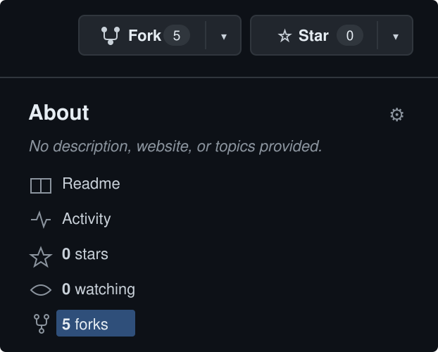
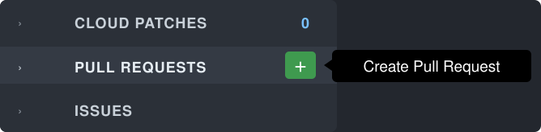
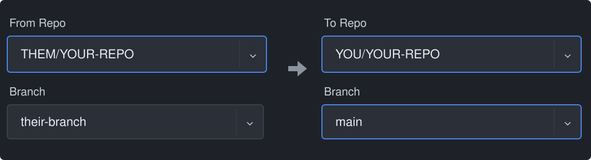

# Review - Pull Requests Across Forks

*Originally covered in [Forks and Collaboration](../README.md)*

---

A pull request across forks moves work **from** a fork **to** the repository it was forked from. Three steps.

**1. Find the fork.** On your repository's GitHub page, the fork count opens the list of every fork. Follow each fork's `forked from` line to the newest one.

**2. Start the pull request.** In GitKraken, open your own repository, hover **Pull Requests** in the left panel, and click the green **+**. No plus button means GitHub is not connected yet: **Preferences → Integrations → GitHub**.

**3. Point it at yourself.** **From Repo** is their fork and the branch they worked on. **To Repo** is your repository and `main`. Create it, merge it on GitHub, then pull `main` in your terminal.

| Without GitKraken | How |
|---|---|
| GitHub | Your repository → **Pull requests → New pull request → compare across forks**: head is their fork and branch, base is your `main` |
| Terminal | `gh pr create --repo YOU/YOUR-REPO --base main --head THEM:their-branch --title "Bring in THEM's work"` |

---

## Tasks

1. Open your repository's fork list and follow the `forked from` chain to the fork of a fork with the newest work on your code. Note its owner and branch.
2. In GitKraken, create the pull request: **From** their fork and branch, **To** your repository and `main`. Check that the arrow points at you before you create it.
3. Merge it on GitHub, then in your terminal pull `main` and confirm the merge commit is at the top of `git log --oneline -3`.
