# The Network Stack
*The network stack is the set of layers every message passes through to cross the internet, each one adding its own wrapper and doing one job.*

---

![Animated diagram of one web request being wrapped by four layers. Application, layer 4, says what to say: the HTTP message GET /index.html. Transport, layer 3, adds a TCP header with port 443 and piece 1 of 3: which program, and did it all arrive. Internet, layer 2, adds an IP header addressed to 199.36.158.100: which computer, anywhere on Earth. Link, layer 1, adds a frame header addressed to the next hop only. A caption says wrappers go on from top to bottom on the way out and come off in reverse on arrival, and that a router opens only the frame and the IP header and never reads your message.](../assets/packet-layers.svg)

Your website does not travel as one thing. It is cut into small pieces, and every piece finds its own way.

- **The four layers:** each layer wraps the message once and does one job.
- **One page over TCP:** the careful way, where every piece is numbered, checked, and sent again if it is lost.
- **The same page over UDP:** the fast way, where pieces are sent once and never checked.

## Table of Contents

1. [The four layers every message is wrapped in](#the-four-layers)
2. [One page over TCP, stage by stage](#one-page-over-tcp)
3. [The same page over UDP, and why anyone would choose it](#the-same-page-over-udp)

## The Four Layers

Mailing a whole book is hard. Mailing it one numbered postcard at a time is easy: each postcard is small, each can take a different truck, and the reader puts them back in order. A **packet** is one postcard.

Each layer writes on the outside of the postcard and never reads what the other layers wrote.

| Layer | Its one job | Its wrapper adds | You have met it as |
|---|---|---|---|
| **4. Application** | What to say | The message itself | HTTP, WebSocket, DNS |
| **3. Transport** | Which program gets it, and whether it all arrived | A **port** and a piece number | TCP, UDP |
| **2. Internet** | Which computer, anywhere on Earth | An **IP address** | IP, such as `199.36.158.100` |
| **1. Link** | Reaching the very next device | The next hop's hardware address | Wi-Fi, Ethernet, fiber |

- **TCP and UDP** are the two ways the transport layer can carry the postcards. The next two sections follow one page through each.
- **HTTP and WebSocket** are two ways the application layer can talk, and both ride on TCP: HTTP asks once and gets one answer, and a WebSocket keeps the line open.

### Activity 1

<strong>Read One Request by Layer</strong>

*Concept: Catch your own website being delivered and point at the part of the request that each layer handled.*

## Task

1. Open your own live website in your browser, open DevTools, and select the **Network** tab.
2. Right-click any column heading in the Network tab and turn on **Protocol** and **Remote Address**.
3. Reload the page. Every row that appears is one request.
4. Click the first row, the page itself. Write down its **Status**, its **Protocol**, and its **Remote Address**.
5. Split the Remote Address at the colon. Say which half is the internet layer and which half is the transport layer.
6. Count the rows. That is how many separate questions your browser asked to draw one page.

*(Standalone file: [activities/01-read-one-request-by-layer.md](../activities/01-read-one-request-by-layer.md))*

## One Page Over TCP

You type an address and a page appears. Here is everything that happens in between, one stage at a time.

1. 

   **Say hello first.** Before anything is sent, the two computers check that the other one is really there and listening, like saying hello on the phone before you start talking.

2. 

   **Ask for the page.** Your browser sends one short note: please give me `index.html`. The server finds that file.

3. 

   **Cut the page into chunks.** The page is too big to send in one go, so the server cuts it into small pieces, like tearing a letter into postcards.

4. 

   **Number every chunk.** Each postcard gets a number and your address, so they can be put back in order no matter how they arrive.

5. 

   **Send them over the wire.** Every chunk travels on its own. They take different roads, show up in a different order, and sometimes one gets lost.

6. 

   **Put them back in order.** Your computer lines the chunks up by number. Now it can see that number 3 is not there.

7. 

   **Ask again for the missing one.** Your computer tells the server exactly what it has, and the server sends the missing chunk again. TCP keeps asking until every chunk is there.

8. 

   **Join the chunks into the page.** With every chunk in place, they are glued back together and the page appears, exactly as it was written.

## The Same Page Over UDP

Now send the same page the other way. UDP does less work at every stage, and that is the whole point of it.

1. 

   **No hello: just start.** Nobody checks that the other side is listening. The server just starts sending, which is faster.

2. 

   **Cut into chunks, with no numbers.** The page is cut up the same way, but the postcards get no numbers and nobody keeps a list of them.

3. 

   **Send them over the wire.** Same roads, same routers, same trouble: the chunks arrive in a different order and one gets lost.

4. 

   **Use them as they land.** With no numbers, the chunks are used in the order they showed up. The lost one is never asked for, so the page comes out broken. That is why web pages travel by TCP.

5. 

   **So why does anyone use it?** In a video call or a fast game, a late picture is useless. UDP skips what was lost and stays live, while TCP would freeze and wait.

| | TCP | UDP |
|---|---|---|
| **Says hello first** | Yes | No |
| **Numbers the chunks** | Yes | No |
| **Sends a lost chunk again** | Yes | No |
| **Good for** | Web pages, files, logins: every piece must arrive | Video calls, live games: being on time matters more |

---

← Back to [lesson](../README.md)
